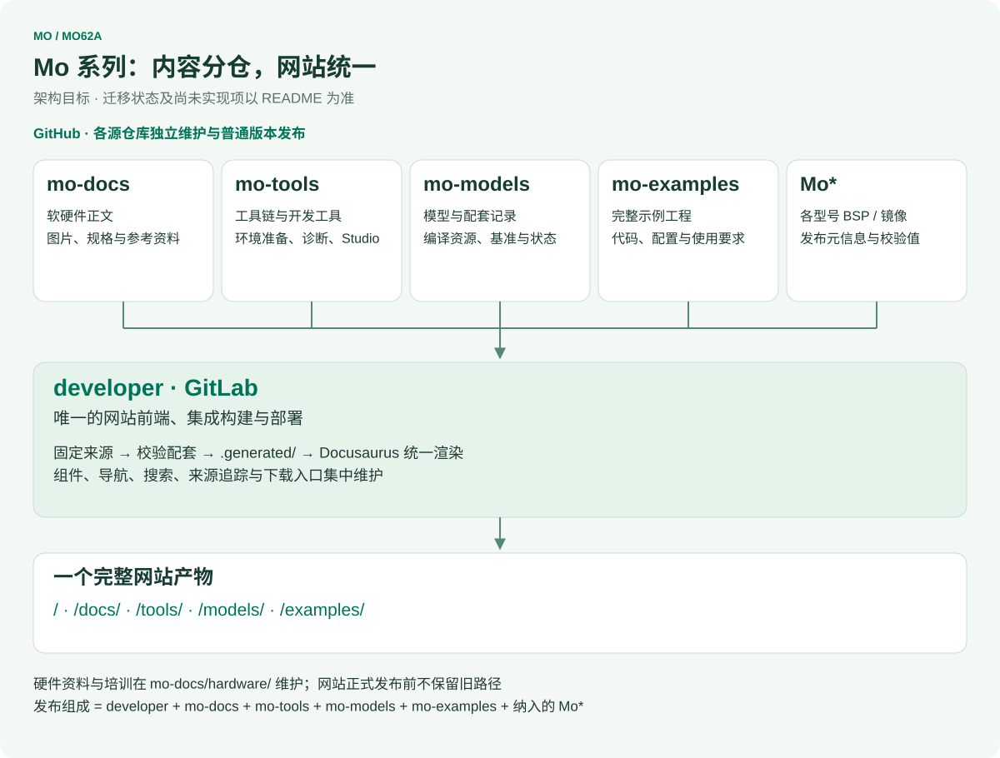
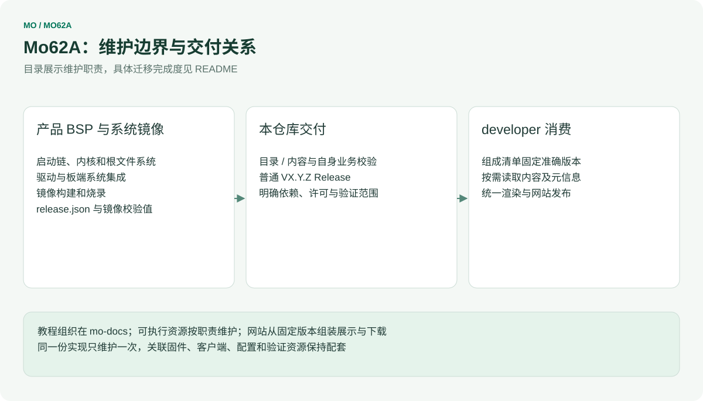
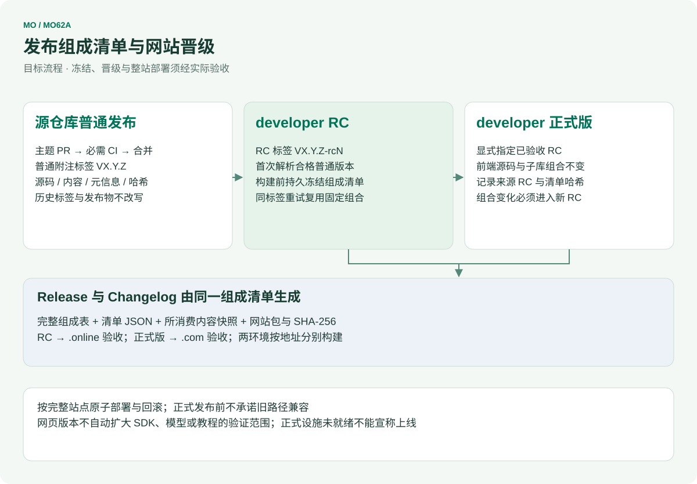

# MO-62A SDK

MO-62A 单板计算机 SDK，基于 TI AM62A7 平台，提供高达 2 TOPS AI 推理性能。

[English](README.md) · [下载与更新日志](RELEASES.md) · [贡献与发布规范](CONTRIBUTING.zh-CN.md)

## Mo 系列仓库协同架构

[](architecture/repository-map.zh-CN.svg)

<table width="100%">
  <thead>
    <tr>
      <th width="171" align="left">仓库</th>
      <th width="398" align="left">人工维护的源内容</th>
      <th width="379" align="left">交付职责</th>
    </tr>
  </thead>
  <tbody>
    <tr>
      <td align="left"><strong>developer</strong> · GitLab</td>
      <td align="left">网站组件、路由、搜索、接入层与内容接口</td>
      <td align="left">完整网站、发布组成清单与部署</td>
    </tr>
    <tr>
      <td align="left"><a href="https://github.com/inhandnet/mo-docs">mo-docs</a></td>
      <td align="left">软硬件教程、规格、媒体、设计资料与维护培训</td>
      <td align="left">版本化内容与参考附件</td>
    </tr>
    <tr>
      <td align="left"><a href="https://github.com/inhandnet/mo-tools">mo-tools</a></td>
      <td align="left">工具链/SDK 选择、环境准备、通用开发工具与 Studio</td>
      <td align="left">工具元信息和源码包</td>
    </tr>
    <tr>
      <td align="left"><a href="https://github.com/inhandnet/mo-models">mo-models</a></td>
      <td align="left">模型目录、编译资源、兼容关系与原始基准</td>
      <td align="left">模型引用、验证证据与托管状态</td>
    </tr>
    <tr>
      <td align="left"><a href="https://github.com/inhandnet/mo-examples">mo-examples</a></td>
      <td align="left">完整示例及配套固件、客户端和配置</td>
      <td align="left">示例源码及适用条件</td>
    </tr>
    <tr>
      <td align="left"><strong>Mo*</strong> · 各型号仓库</td>
      <td align="left">各自 BSP、驱动、根文件系统、镜像构建与烧录</td>
      <td align="left">系统镜像及带校验值的发布元信息</td>
    </tr>
  </tbody>
</table>

`Mo*` 表示各型号独立的产品仓库，例如 [Mo62A](https://github.com/inhandnet/Mo62A)、Mo68A、Mo69A、Mo67A、Mo3588、Mo3568，框架不固定数量。硬件资料与维护培训已在 mo-docs 维护；已归档的 mo-hardware 仓库只是迁移记录，网站正式发布前不保留旧的 `/hardware-docs/` 路径。

各源仓库独立发布普通版本，只有 developer 区分网站 RC 与正式版。目标发布组成绑定 **developer + mo-docs + mo-tools + mo-models + mo-examples + 纳入的 Mo\***，记录准确提交与所消费附件哈希。上游新发版本不会改变已冻结的网站组合。教程适用范围、PCB 修订、镜像版本和实际验证结论分别记录。

## 本产品仓库的边界

[](architecture/ownership.zh-CN.svg)

Mo62A 继续维护 BSP、驱动、镜像构建、烧录与系统集成。网站迁移不要求更改内核、重建镜像或把大镜像下载到前端构建中；developer 消费固定 Release 的 release.json 和 SHA256SUMS。镜像是否实机启动通过，以该 Release 的 validation 字段和实际证据为准。

每个 Release 还附带 SPDX 格式的 SBOM（`mo62a-trixie-xfce-<version>.spdx.json`），列出镜像中的 Debian 软件包和内核。安全漏洞请按 [SECURITY.md](SECURITY.md) 私密报告，不要提交公开 Issue。

以下 BSP 开发说明保持原有用途；工具、模型和完整应用的跨仓引用按各自固定版本衔接。本文框架图为统一架构目标，不表示发布冻结或整站上线已完成。

[](architecture/release-flow.zh-CN.svg)

---

## 目录

- [1. 概述](#1-概述)
- [2. 环境搭建](#2-环境搭建)
  - [2.1 主机系统要求](#21-主机系统要求)
  - [2.2 克隆仓库](#22-克隆仓库)
  - [2.3 使用 setup.sh 初始化环境](#23-使用-setupsh-初始化环境)
  - [2.4 工具链](#24-工具链)
  - [2.5 从源码构建完整镜像](#25-从源码构建完整镜像)
- [3. U-Boot](#3-u-boot)
  - [3.1 相关文件](#31-相关文件)
  - [3.2 编译 U-Boot](#32-编译-u-boot)
  - [3.3 归档编译产物](#33-归档编译产物)
  - [3.4 编译输出](#34-编译输出)
- [4. Linux 内核](#4-linux-内核)
  - [4.1 相关文件](#41-相关文件)
  - [4.2 编译 DTB](#42-编译-dtb)
  - [4.3 编译内核](#43-编译内核)
  - [4.4 归档编译产物](#44-归档编译产物)
  - [4.5 编译输出](#45-编译输出)
  - [4.6 按变更类型选择编译步骤](#46-按变更类型选择编译步骤)
- [5. 烧录 SD 卡](#5-烧录-sd-卡)
  - [5.1 前提条件](#51-前提条件)
  - [5.2 启动烧录工具](#52-启动烧录工具)
  - [5.3 在线烧录（直接写入 SD 卡）](#53-在线烧录直接写入-sd-卡)
  - [5.4 离线镜像制作（balenaEtcher）](#54-离线镜像制作balenaetcher)
  - [5.5 自定义 Rootfs 压缩包（添加 apt 软件包）](#55-自定义-rootfs-压缩包添加-apt-软件包)
- [6. 分区布局](#6-分区布局)
  - [6.1 BOOT 分区内容](#61-boot-分区内容)
  - [6.2 启动配置](#62-启动配置)
- [7. 硬件参考](#7-硬件参考)
  - [7.1 整体框图](#71-整体框图)
  - [7.2 供电系统](#72-供电系统)
  - [7.3 I2C 设备地址映射](#73-i2c-设备地址映射)
  - [7.4 内存](#74-内存)
  - [7.5 存储](#75-存储)
  - [7.6 显示——Micro HDMI](#76-显示micro-hdmi)
  - [7.7 网络——千兆以太网](#77-网络千兆以太网)
  - [7.8 USB](#78-usb)
  - [7.9 无线——Wi-Fi / 蓝牙](#79-无线wi-fi--蓝牙)
  - [7.10 音频](#710-音频)
  - [7.11 RTC](#711-rtc)
  - [7.12 扩展接口](#712-扩展接口)
  - [7.13 调试接口](#713-调试接口)
  - [7.14 启动配置](#714-启动配置)
  - [7.15 JTAG 接口](#715-jtag-接口)
  - [7.16 硬件版本识别引脚](#716-硬件版本识别引脚)
- [8. 显示——DPMS 息屏与唤醒](#8-显示dpms-息屏与唤醒)
- [9. S1 电源键](#9-s1-电源键)
- [10. EEPROM](#10-eeprom)
- [11. MO-62A 自动化测试工具](#11-mo-62a-自动化测试工具)

---

## 1. 概述

MO-62A 是一款基于 TI AM62A7 处理器的单板计算机，专为边缘 AI 推理、机器视觉和工业控制应用设计。AM62A7 集成了四核 Arm Cortex-A53（最高 1.4 GHz）、一个 Cortex-R5F 实时处理器，以及专用 MMA（矩阵乘法加速器），AI 推理性能高达 2 TOPS。

本 SDK 基于 **TI Processor SDK Linux RT EdgeAI AM62A EVM 11.01.07.05** 构建，为 MO-62A 板卡提供完整的硬件定制支持，包含以下组件：

- **U-Boot**：为 MO-62A 定制的引导加载程序，包含 R5 SPL 和 A53 U-Boot
- **Linux 内核**：基于 TI Linux RT 内核，为 MO-62A 定制的内核和设备树
- **构建系统**：统一的基于 Makefile 的编译与归档工作流
- **烧录工具**：支持直接写入 SD 卡和创建离线 balenaEtcher 镜像

SDK 目录结构概览：

```
mo-62a/
├── board-support/          # U-Boot、内核源码及预编译镜像
│   ├── built-images/       # 归档编译产物（归档后生成）
│   ├── prebuilt-images/    # TI 预编译固件（bl31、bl32、ti-dm 等）
│   └── extra-applications/ # 板卡专用附加应用
├── bin/                    # 辅助脚本及烧录工具
│   ├── mo-62a-flash.sh     # 统一烧录工具
│   └── extlinux/           # U-Boot extlinux 启动配置
├── filesystem/             # rootfs 压缩包目录
├── linux-devkit/           # AArch64 交叉编译工具链
├── k3r5-devkit/            # ARMv7 R5 交叉编译工具链
├── makerules/              # 各组件 Makefile 规则
├── Makefile                # 顶层 Makefile
├── Rules.make              # 全局路径与平台配置
└── setup.sh                # 开发主机初始化脚本
```

---

## 2. 环境搭建

### 2.1 主机系统要求

以下主机环境已经过编译验证：

<table width="100%">
  <thead>
    <tr>
      <th width="284" align="left">项目</th>
      <th width="664" align="left">要求</th>
    </tr>
  </thead>
  <tbody>
    <tr>
      <td align="left">操作系统</td>
      <td align="left">Ubuntu 22.04 LTS（x86_64）</td>
    </tr>
    <tr>
      <td align="left">内核版本</td>
      <td align="left">6.8.0 或更高</td>
    </tr>
    <tr>
      <td align="left">架构</td>
      <td align="left">x86_64</td>
    </tr>
  </tbody>
</table>

所需主机软件包：

```bash
sudo apt-get install \
  xinetd tftpd nfs-kernel-server minicom \
  build-essential libncurses5-dev autoconf automake \
  dos2unix screen lrzsz lzop flex libssl-dev \
  u-boot-tools make git parted dosfstools e2fsprogs \
  pv xz-utils zip wget curl
```

### 2.2 克隆仓库

将 MO-62A SDK 克隆到主机任意目录：

```bash
git clone https://github.com/inhandnet/mo-62a.git
cd mo-62a
```

### 2.3 使用 setup.sh 初始化环境

在 SDK 根目录执行 `setup.sh` 以初始化开发主机：

```bash
./setup.sh
```

该脚本执行以下步骤：

1. **验证**主机操作系统（Ubuntu 22.04 LTS）
2. **将**当前用户添加到 `dialout` 组（串口访问所需）
3. **安装**所需主机软件包——按 `Y` 安装，按 `n` 跳过（如已安装）
4. **写入** `TI_SDK_PATH` 到 `~/.bashrc`，指向克隆的仓库根目录，确保该变量在 shell 会话间持久有效
5. **创建**符号链接 `/opt/ti-processor-sdk-linux-rt-edgeai-am62a-evm-11.01.07.05` 指向克隆的仓库，这是因为交叉编译工具链二进制文件中硬编码了该路径作为 ELF 解释器路径

示例输出：

```
-------------------------------------------------------------------------------
MO-62A SDK setup script
SDK root: /home/user/mo-62a
-------------------------------------------------------------------------------

Verifying Linux host distribution
Ubuntu 22.04 LTS is being used, continuing..

User 'user' is already in the 'dialout' group.

Do you wish to install required host packages? (Y/n) n
Host package installation skipped.

TI_SDK_PATH is already set correctly in /home/user/.bashrc:
  export TI_SDK_PATH="/home/user/mo-62a"
TI_SDK_PATH is now set to: /home/user/mo-62a

Creating toolchain symlink...
  /opt/ti-processor-sdk-linux-rt-edgeai-am62a-evm-11.01.07.05 -> /home/user/mo-62a

-------------------------------------------------------------------------------
MO-62A SDK setup completed!
You can now build the SDK from: /home/user/mo-62a
-------------------------------------------------------------------------------
```

> **注意：** `setup.sh` 完成后，`TI_SDK_PATH` 在当前 shell 中立即生效，并通过 `~/.bashrc` 在所有后续 shell 会话中自动设置。重复执行 `setup.sh` 是安全的——脚本会更新符号链接和 `TI_SDK_PATH` 条目，不会产生重复项。

### 2.4 工具链

SDK 包含两套交叉编译工具链：

**AArch64 工具链**——用于 Linux 内核和 A53 U-Boot：

<table width="100%">
  <thead>
    <tr>
      <th width="284" align="left">项目</th>
      <th width="664" align="left">值</th>
    </tr>
  </thead>
  <tbody>
    <tr>
      <td align="left">路径</td>
      <td align="left"><code>linux-devkit/sysroots/x86_64-arago-linux/usr/bin/aarch64-oe-linux/</code></td>
    </tr>
    <tr>
      <td align="left">前缀</td>
      <td align="left"><code>aarch64-oe-linux-</code></td>
    </tr>
    <tr>
      <td align="left">GCC 版本</td>
      <td align="left">13.4.0</td>
    </tr>
    <tr>
      <td align="left">目标 sysroot</td>
      <td align="left"><code>linux-devkit/sysroots/aarch64-oe-linux/</code></td>
    </tr>
  </tbody>
</table>

**ARMv7 R5 工具链**——用于 R5 SPL（tiboot3）：

<table width="100%">
  <thead>
    <tr>
      <th width="284" align="left">项目</th>
      <th width="664" align="left">值</th>
    </tr>
  </thead>
  <tbody>
    <tr>
      <td align="left">路径</td>
      <td align="left"><code>k3r5-devkit/sysroots/x86_64-arago-linux/usr/bin/arm-oe-eabi/</code></td>
    </tr>
    <tr>
      <td align="left">前缀</td>
      <td align="left"><code>arm-oe-eabi-</code></td>
    </tr>
    <tr>
      <td align="left">GCC 版本</td>
      <td align="left">13.4.0</td>
    </tr>
    <tr>
      <td align="left">目标 sysroot</td>
      <td align="left"><code>k3r5-devkit/sysroots/armv7at2hf-vfp-oe-eabi/</code></td>
    </tr>
  </tbody>
</table>

验证两套工具链均可用（执行 `setup.sh` 完成后运行）：

```bash
# AArch64
linux-devkit/sysroots/x86_64-arago-linux/usr/bin/aarch64-oe-linux/aarch64-oe-linux-gcc --version

# ARMv7 R5
k3r5-devkit/sysroots/x86_64-arago-linux/usr/bin/arm-oe-eabi/arm-oe-eabi-gcc --version
```

预期输出：

```
aarch64-oe-linux-gcc (GCC) 13.4.0
Copyright (C) 2023 Free Software Foundation, Inc.

arm-oe-eabi-gcc (GCC) 13.4.0
Copyright (C) 2023 Free Software Foundation, Inc.
```

> **注意：** 工具链二进制文件中硬编码了 ELF 解释器路径 `/opt/ti-processor-sdk-linux-rt-edgeai-am62a-evm-11.01.07.05/`。`setup.sh` 创建的符号链接可满足此要求，无论仓库克隆到何处。工具链通过 `Rules.make` 自动调用，无需手动导出 PATH。

---

### 2.5 从源码构建完整镜像

本节给出外部用户仅凭本仓库生成可启动镜像的端到端顺序。每一步的细节都在所指向的章节中，本节不替代那些章节。

1. **克隆并拉取大文件。** 基础根文件系统 `filesystem/debian-13.5-edgeai-base-arm64.tar.xz`（约 1.3 GB）及其他二进制文件通过 Git LFS 存储（见 `.gitattributes`）。普通克隆只会得到指针文件，因此需要：

   ```bash
   git clone https://github.com/inhandnet/Mo62A.git
   cd Mo62A
   git lfs install
   git lfs pull
   ```

2. **准备主机。** 安装主机软件包并运行 `setup.sh`（第 2.3 节），再配置工具链（第 2.4 节）。烧录工具还需要 `qemu-user-static` 及可用的 AArch64 binfmt 支持，因为 EdgeAI C++ SDK 在 arm64 chroot 中编译（第 5.4.1 节）。
3. **编译 U-Boot**（第 3.2–3.3 节）和**内核、模块与设备树**（第 4.2–4.4 节），并按说明归档产物。内核构建依赖 U-Boot 构建，因为需要组装 FIT 镜像。
4. **组装镜像。** 交互式运行烧录工具（第 5.2 节）直接写入 SD 卡（第 5.3 节）或生成离线镜像（第 5.4 节），无人值守构建使用非交互形式（第 5.4.1 节）。组装过程中工具会解压基础 rootfs、复制 `board-support/rootfs-overlay/`，并编译安装 `board-support/extra-applications/*/Makefile` 与 `board-support/extra-drivers/` 下的所有项目。
5. **自定义 rootfs**：需要不同 apt 软件包或库时，按第 5.5 节重新打包基础压缩包，再让烧录工具使用新的归档。

结果是一张 SD 卡或带 `.sha256` 校验文件的 `.img.xz`。对外发布的镜像使用同样的步骤生成；正式发布另附发布工作流生成的版本对照表与更新日志（见 [RELEASES.md](RELEASES.md)）。

## 3. U-Boot

### 3.1 相关文件

添加到 U-Boot 源码树中的 MO-62A 专用文件：

<table width="100%">
  <thead>
    <tr>
      <th width="284" align="left">文件</th>
      <th width="664" align="left">描述</th>
    </tr>
  </thead>
  <tbody>
    <tr>
      <td align="left"><code>board-support/ti-u-boot-2025.01+git/configs/am62ax_mo_62a_a53_defconfig</code></td>
      <td align="left">A53 U-Boot defconfig</td>
    </tr>
    <tr>
      <td align="left"><code>board-support/ti-u-boot-2025.01+git/configs/am62ax_mo_62a_r5_defconfig</code></td>
      <td align="left">R5 SPL defconfig</td>
    </tr>
    <tr>
      <td align="left"><code>board-support/ti-u-boot-2025.01+git/dts/upstream/src/arm64/ti/k3-am62a7-mo-62a.dts</code></td>
      <td align="left">A53 主设备树</td>
    </tr>
    <tr>
      <td align="left"><code>board-support/ti-u-boot-2025.01+git/dts/upstream/src/arm64/ti/k3-am62a7-mo-62a-pinmux.dtsi</code></td>
      <td align="left">引脚复用配置</td>
    </tr>
    <tr>
      <td align="left"><code>board-support/ti-u-boot-2025.01+git/arch/arm/dts/k3-am62a7-r5-mo-62a.dts</code></td>
      <td align="left">R5 SPL 设备树</td>
    </tr>
    <tr>
      <td align="left"><code>board-support/ti-u-boot-2025.01+git/arch/arm/dts/k3-am62a7-mo-62a-u-boot.dtsi</code></td>
      <td align="left">U-Boot 专用 DT 扩展</td>
    </tr>
    <tr>
      <td align="left"><code>board-support/ti-u-boot-2025.01+git/arch/arm/dts/k3-am62a7-mo-62a-binman.dtsi</code></td>
      <td align="left">Binman 打包配置</td>
    </tr>
    <tr>
      <td align="left"><code>board-support/ti-u-boot-2025.01+git/arch/arm/dts/k3-am62a7-mo-62a-lp4-4GB.dtsi</code></td>
      <td align="left">LPDDR4 4GB 内存配置</td>
    </tr>
  </tbody>
</table>

编译期间所需的预编译固件（来自 TI，未修改）：

<table width="100%">
  <thead>
    <tr>
      <th width="284" align="left">文件</th>
      <th width="664" align="left">描述</th>
    </tr>
  </thead>
  <tbody>
    <tr>
      <td align="left"><code>board-support/prebuilt-images/am62a-evm/bl31.bin</code></td>
      <td align="left">Arm Trusted Firmware（TF-A）</td>
    </tr>
    <tr>
      <td align="left"><code>board-support/prebuilt-images/am62a-evm/bl32.bin</code></td>
      <td align="left">OP-TEE OS</td>
    </tr>
    <tr>
      <td align="left"><code>board-support/prebuilt-images/am62a-evm/ti-dm/am62axx/dm_edgeai_mcu1_0_release_strip.out</code></td>
      <td align="left">TI 设备管理器固件</td>
    </tr>
  </tbody>
</table>

### 3.2 编译 U-Boot

U-Boot 分两步编译——先编译 R5 SPL，再编译 A53 U-Boot。两者均通过 SDK 根目录的顶层 `make` 调用。

**编译 R5 SPL（tiboot3）：**

```bash
make u-boot-r5
```

使用 `am62ax_mo_62a_r5_defconfig` 配置 R5 编译，并使用 ARMv7 R5 工具链（`arm-oe-eabi-`）进行编译。输出位于 `board-support/u-boot-build/r5/`。

**编译 A53 U-Boot：**

```bash
make u-boot-a53
```

使用 `am62ax_mo_62a_a53_defconfig` 配置 A53 编译，并使用 AArch64 工具链（`aarch64-oe-linux-`），通过 binman 集成 `bl31.bin`、`bl32.bin` 和 TI 设备管理器固件。输出位于 `board-support/u-boot-build/a53/`。

**一步编译两者：**

```bash
make u-boot
```

### 3.3 归档编译产物

编译成功后，将输出二进制文件复制到 `board-support/built-images/`：

```bash
make u-boot_stage
```

### 3.4 编译输出

归档完成后，`board-support/built-images/` 中包含以下文件：

<table width="100%">
  <thead>
    <tr>
      <th width="209" align="left">文件</th>
      <th width="246" align="left">大小</th>
      <th width="246" align="left">来源</th>
      <th width="247" align="left">描述</th>
    </tr>
  </thead>
  <tbody>
    <tr>
      <td align="left"><code>tiboot3-am62ax-gp-mo-62a.bin</code></td>
      <td align="left">~318 KB</td>
      <td align="left">R5 编译</td>
      <td align="left">适用于 GP（通用）设备的 R5 SPL</td>
    </tr>
    <tr>
      <td align="left"><code>tiboot3-am62ax-hs-fs-mo-62a.bin</code></td>
      <td align="left">~320 KB</td>
      <td align="left">R5 编译</td>
      <td align="left">适用于 HS-FS（高安全、可量产）设备的 R5 SPL</td>
    </tr>
    <tr>
      <td align="left"><code>tiboot3-am62ax-hs-mo-62a.bin</code></td>
      <td align="left">~320 KB</td>
      <td align="left">R5 编译</td>
      <td align="left">适用于 HS（高安全）设备的 R5 SPL</td>
    </tr>
    <tr>
      <td align="left"><code>tiboot3.bin</code></td>
      <td align="left">~320 KB</td>
      <td align="left">R5 编译</td>
      <td align="left">默认 tiboot3（HS-FS，烧录工具使用）</td>
    </tr>
    <tr>
      <td align="left"><code>tispl.bin</code></td>
      <td align="left">~1.7 MB</td>
      <td align="left">A53 编译</td>
      <td align="left">TI SPL——加载 OP-TEE、TF-A 和 A53 U-Boot</td>
    </tr>
    <tr>
      <td align="left"><code>u-boot.img</code></td>
      <td align="left">~1.2 MB</td>
      <td align="left">A53 编译</td>
      <td align="left">A53 U-Boot FIT 镜像</td>
    </tr>
  </tbody>
</table>

> **注意：** 具体使用哪个 `tiboot3-*.bin` 变体取决于设备安全状态。大多数量产 MO-62A 板卡出厂为 HS-FS，使用 `tiboot3-am62ax-hs-fs-mo-62a.bin`。烧录工具默认使用 `tiboot3.bin`（即 HS-FS 变体的副本）。

---

## 4. Linux 内核

### 4.1 相关文件

添加到 Linux 内核源码树中的 MO-62A 专用文件：

<table width="100%">
  <thead>
    <tr>
      <th width="284" align="left">文件</th>
      <th width="664" align="left">描述</th>
    </tr>
  </thead>
  <tbody>
    <tr>
      <td align="left"><code>board-support/ti-linux-kernel-6.12.35+git-ti-rt/arch/arm64/configs/am62ax_mo_62a_defconfig</code></td>
      <td align="left">MO-62A 基础内核 defconfig</td>
    </tr>
    <tr>
      <td align="left"><code>board-support/ti-linux-kernel-6.12.35+git-ti-rt/arch/arm64/boot/dts/ti/k3-am62a7-mo-62a.dts</code></td>
      <td align="left">MO-62A 主设备树</td>
    </tr>
    <tr>
      <td align="left"><code>board-support/ti-linux-kernel-6.12.35+git-ti-rt/arch/arm64/boot/dts/ti/k3-am62a7-mo-62a-pinmux.dtsi</code></td>
      <td align="left">引脚复用配置</td>
    </tr>
  </tbody>
</table>

编译时在 defconfig 基础上叠加应用的内核配置片段：

<table width="100%">
  <thead>
    <tr>
      <th width="246" align="left">片段</th>
      <th width="351" align="left">位置</th>
      <th width="351" align="left">用途</th>
    </tr>
  </thead>
  <tbody>
    <tr>
      <td align="left"><code>ti_arm64_prune.config</code></td>
      <td align="left"><code>kernel/configs/</code></td>
      <td align="left">移除非 TI ARM64 平台支持，减小编译体积</td>
    </tr>
    <tr>
      <td align="left"><code>ti_rt.config</code></td>
      <td align="left"><code>kernel/configs/</code></td>
      <td align="left">启用 PREEMPT_RT 实时内核补丁</td>
    </tr>
  </tbody>
</table>

### 4.2 编译 DTB

编译所有设备树 blob（共 62 个 DTB 和 DTBO）：

```bash
make linux-dtbs
```

该命令使用 `am62ax_mo_62a_defconfig` + `ti_arm64_prune.config` + `ti_rt.config` 配置内核，然后编译所有匹配 `Rules.make` 中定义前缀模式的 DTB：

```
ti/k3-am62a7  ti/k3-fpdlink  ti/k3-am62x-sk  ti/k3-v3link
```

输出位于 `board-support/ti-linux-kernel-6.12.35+git-ti-rt/arch/arm64/boot/dts/`。

### 4.3 编译内核

编译内核镜像、模块和 FitImage：

```bash
make linux
```

该命令按顺序执行以下步骤：

1. 编译 DTB（自动调用 `linux-dtbs`）
2. 编译 U-Boot（自动调用 `u-boot`，FitImage 签名密钥所需）
3. 编译 `Image` 和 `Image.gz`
4. 编译内核模块
5. 使用 `mkimage` 和 U-Boot 签名密钥，结合 `board-support/prebuilt-images/am62a-evm/` 中的 ITS 模板，打包并签名 `fitImage`
6. 重新编译 A53 U-Boot（binman），将 MO-62A DTB 嵌入 `tispl.bin`

### 4.4 归档编译产物

将内核和 DTB 输出复制到 `board-support/built-images/`：

```bash
make linux_stage
```

### 4.5 编译输出

归档完成后，`board-support/built-images/` 中新增以下文件：

<table width="100%">
  <thead>
    <tr>
      <th width="246" align="left">文件</th>
      <th width="351" align="left">大小</th>
      <th width="351" align="left">描述</th>
    </tr>
  </thead>
  <tbody>
    <tr>
      <td align="left"><code>Image</code></td>
      <td align="left">~18 MB</td>
      <td align="left">未压缩内核镜像</td>
    </tr>
    <tr>
      <td align="left"><code>Image.gz</code></td>
      <td align="left">~7.0 MB</td>
      <td align="left">压缩内核镜像</td>
    </tr>
    <tr>
      <td align="left"><code>fitImage</code></td>
      <td align="left">~7.3 MB</td>
      <td align="left">签名 FIT 镜像（内核 + DTB），用于验证启动</td>
    </tr>
    <tr>
      <td align="left"><code>dtb/ti/*.dtb</code> / <code>dtb/ti/*.dtbo</code></td>
      <td align="left">—</td>
      <td align="left">62 个设备树 blob 和覆盖层</td>
    </tr>
  </tbody>
</table>

> **注意：** `fitImage` 使用 U-Boot 源码树中的 `custMpk` 密钥签名。签名步骤同时触发 `tispl.bin` 的重新编译，使其嵌入 MO-62A DTB（`k3-am62a7-mo-62a.dtb`）。因此，`make linux` 始终会同时更新 `built-images/` 中的 `fitImage` 和 `tispl.bin`。

### 4.6 按变更类型选择编译步骤

烧录工具在在线和离线烧录时都会执行 `make modules_install`。该步骤会**无条件覆盖** rootfs 中整个 `/lib/modules/<version>/` 目录，将其替换为当前内核源码树中已存在的 `.ko` 文件。如果事先没有完整编译内核模块，rootfs 中原有的所有模块（DRM/HDMI、Wi-Fi、PWM 风扇、温度传感器等）将被清空，只剩下当时源码树中碰巧存在的模块文件。

请根据下表判断运行烧录工具前需要执行哪些编译步骤：

<table width="100%">
  <thead>
    <tr>
      <th width="284" align="left">变更类型</th>
      <th width="664" align="left">必要的编译步骤</th>
    </tr>
  </thead>
  <tbody>
    <tr>
      <td align="left">仅修改 DTS / 引脚复用</td>
      <td align="left"><code>make linux-dtbs</code> → <code>make linux-dtbs_stage</code> → <strong><code>make linux</code></strong> → <code>make linux_stage</code></td>
    </tr>
    <tr>
      <td align="left">修改内核源码（<code>.c</code> / <code>.h</code>）</td>
      <td align="left"><code>make linux</code> → <code>make linux_stage</code></td>
    </tr>
    <tr>
      <td align="left">修改 U-Boot 源码</td>
      <td align="left"><code>make u-boot</code> → <code>make u-boot_stage</code></td>
    </tr>
    <tr>
      <td align="left">仅修改 rootfs overlay（脚本、服务文件）</td>
      <td align="left">无需重新编译内核——烧录工具会自动复制 overlay</td>
    </tr>
  </tbody>
</table>

> **重要：** 即使只修改了 DTS 文件，烧录前也必须执行 `make linux`（或确认内核源码树中已有完整编译好的 `.ko` 文件）。**仅运行 `make linux-dtbs` 是不够的**，因为它不会编译内核模块。

完整的固件发布编译流程如下：

```bash
# 1. 完整内核编译——编译 Image、全部模块和 FitImage
make linux

# 2. 将 Image 和 DTB 归档到 built-images/
make linux_stage
make linux-dtbs_stage

# 3.（可选）如果 U-Boot 源码有改动，重新编译 U-Boot
make u-boot
make u-boot_stage

# 4. 烧录
sudo bash bin/mo-62a-flash.sh
```

---

## 5. 烧录 SD 卡

统一烧录工具 `bin/mo-62a-flash.sh` 支持两种输出目标：

- **在线烧录**——直接写入物理 SD 卡
- **离线镜像制作**——创建 `.img` 文件供 balenaEtcher 使用

两种模式产生完全相同的分区布局和内容。

### 5.1 前提条件

所需主机软件包（由 `setup.sh` 安装）：

```
parted  dosfstools  e2fsprogs  pv  xz-utils  zip  wget  curl
```

运行烧录工具前，请确认以下条件：

1. **编译产物已归档**——执行 `make u-boot_stage` 和 `make linux_stage`（或 `make all_stage`），确保 `board-support/built-images/` 中包含所需文件
2. **Rootfs 压缩包已就位**——将 `.tar.xz` 或 `.tar.gz` 格式的 rootfs 压缩包放置在 `filesystem/` 目录下
3. **SD 卡已插入**（仅在线模式）——工具自动检测 `/dev/sdX` 和 `/dev/mmcblkN` 块设备

### 5.2 启动烧录工具

不带参数时，烧录工具打开交互菜单，须以 root 权限运行。无人值守的离线镜像制作见 5.4.1 节。

```bash
sudo bash bin/mo-62a-flash.sh
```

启动后提示选择输出目标：

```
=== MO-62A Flash Tool ===

Select output target:
  [1] Write directly to an SD card
  [2] Create offline image for balenaEtcher

Select target [1/2]:
```

### 5.3 在线烧录（直接写入 SD 卡）

选择 `[1]` 进入在线模式。工具将列出所有检测到的块设备：

```
Detected candidate block devices:
  [1] /dev/sda  29.7G  SD Card Reader

Select target device number:
```

然后选择操作模式：

```
Select operation mode:
  [1] full      - create partitions + format + copy BOOT + extract rootfs
  [2] partition - create partitions + format only
  [3] boot      - copy BOOT content only (strict checks, no repartition)
  [4] rootfs    - copy rootfs content only (strict checks, no repartition)

Select mode number (default 1):
```

<table width="100%">
  <thead>
    <tr>
      <th width="284" align="left">模式</th>
      <th width="664" align="left">描述</th>
    </tr>
  </thead>
  <tbody>
    <tr>
      <td align="left"><code>full</code></td>
      <td align="left">全量写入：擦除并重新分区、格式化、复制启动文件、解压 rootfs、安装内核模块</td>
    </tr>
    <tr>
      <td align="left"><code>partition</code></td>
      <td align="left">仅分区：擦除并重建 MBR、格式化分区——不写入任何内容</td>
    </tr>
    <tr>
      <td align="left"><code>boot</code></td>
      <td align="left">仅覆盖 BOOT 分区——重新烧录引导程序和内核，不影响 rootfs</td>
    </tr>
    <tr>
      <td align="left"><code>rootfs</code></td>
      <td align="left">仅覆盖 rootfs 分区——重新解压 rootfs，不影响 BOOT 分区</td>
    </tr>
  </tbody>
</table>

全新 SD 卡请选择 `full`。工具将要求确认（输入 `YES` 继续），然后自动执行：

1. 卸载目标设备上的所有现有分区
2. 擦除旧分区表
3. 创建 MBR 分区表：BOOT（FAT32，256 MiB）+ rootfs（ext4，剩余空间）
4. 格式化两个分区
5. 将启动产物复制到 BOOT 分区：`tiboot3.bin`、`tispl.bin`、`u-boot.img`、`Image`、DTB、`extlinux/`
6. 询问使用哪个 rootfs 压缩包（若 `filesystem/` 下有多个）
7. 将 rootfs 压缩包解压到 rootfs 分区
8. 安装内核模块（`make modules_install`）到 rootfs
9. 编译并安装 `board-support/extra-applications/` 中的外部应用

示例会话（full 模式）：

```
TARGET DEVICE: /dev/sda (29.7G)

MODE: full
This will ERASE ALL DATA on /dev/sda.

Destructive operation — please confirm.
Type YES to continue: YES

Checking mounts on /dev/sda ...
Wiping old partition table signatures...
Creating MBR partitions (BOOT FAT32(LBA) 256MiB + rootfs ext4 remaining)...
Formatting BOOT: /dev/sda1 (FAT32)
Formatting rootfs: /dev/sda2 (ext4)
Copying boot artifacts to BOOT partition...

Available rootfs tarballs:
  [1] debian-13.2-xfce-v6.12-arm64-2026-01-13-12gb.tar.xz

Select rootfs tarball number (or 'q' to abort): 1

Extracting rootfs to rootfs partition...
Installing kernel modules into rootfs: /tmp/mo-62a-rootfs.xxx/usr/lib/modules
...
Installed: rtk_hciattach

Done. BOOT and rootfs written successfully.
```

烧录完成后，将 SD 卡插入 MO-62A 板卡并上电。启动日志通过串口控制台 `ttyS2`（115200 8N1）输出。

### 5.4 离线镜像制作（balenaEtcher）

选择 `[2]` 进入镜像制作模式。工具提示输入镜像参数：

```
Available rootfs tarballs:
  [1] debian-13.5-edgeai-base-arm64.tar.xz

Select rootfs tarball number (or 'q' to abort): 1

Output directory (default: <repository>/bin/out): /path/to/output
Version (e.g. V1.0.0) (default: V1.0.0): V1.1.0
Date (YYYY-MM-DD) (default: <today>): 2026-10-15
Image size (GiB, integer) (default: 12): 12
Compression (zip|xz|none) (default: xz): xz
```

<table width="100%">
  <thead>
    <tr>
      <th width="284" align="left">参数</th>
      <th width="664" align="left">描述</th>
    </tr>
  </thead>
  <tbody>
    <tr>
      <td align="left">输出目录</td>
      <td align="left"><code>.img</code> 及校验文件的写入路径</td>
    </tr>
    <tr>
      <td align="left">版本</td>
      <td align="left">用于 <code>mo62a-trixie-xfce-&lt;version&gt;</code> 文件名和外部应用版本</td>
    </tr>
    <tr>
      <td align="left">日期</td>
      <td align="left">写入外部应用的构建日期</td>
    </tr>
    <tr>
      <td align="left">镜像大小（GiB）</td>
      <td align="left">包含 BOOT、4 GiB swap、rootfs 和文件系统开销的总大小，默认 12 GiB</td>
    </tr>
    <tr>
      <td align="left">压缩格式</td>
      <td align="left"><code>xz</code>（默认）、<code>zip</code> 或 <code>none</code>（不压缩）</td>
    </tr>
  </tbody>
</table>

工具创建稀疏 `.img` 文件，通过 loop 设备分区、格式化并安装启动文件和 rootfs，卸载后压缩输出。内核模块、外部应用、外置驱动及 overlay 与直接写卡复用相同的安装函数；这不表示两种文件系统镜像逐字节一致。

输出文件：

```
/path/to/output/
├── mo62a-trixie-xfce-V1.1.0.img       # 原始磁盘镜像
├── mo62a-trixie-xfce-V1.1.0.img.xz    # 压缩镜像（默认）
├── mo62a-trixie-xfce-V1.1.0.sha256    # 镜像文件的 SHA-256 校验值
└── mo62a-factory-V1.1.0.deb          # 独立产测包（对应源文件存在时生成）
```

使用 balenaEtcher 烧录镜像：

1. 打开 [balenaEtcher](https://etcher.balena.io/)
2. 解压 `.img.xz`，点击 **Flash from file** 选择得到的 `.img`
3. 选择目标 SD 卡
4. 点击 **Flash**

> **注意：** 容量须覆盖解压后的 rootfs、安装的模块与应用、BOOT、swap 及文件系统开销。默认大小不保证能容纳所有自定义 rootfs；压缩下载文件大小不等于所需 SD 卡容量。

#### 5.4.1 非交互离线镜像制作

先按前文完成内核、模块、设备树及 U-Boot 的编译与归档。下载 Git LFS 对象，配置工具链路径，并准备应用构建依赖，包括 EdgeAI C++ chroot 构建所需的 `qemu-user-static` 和可用的 AArch64 binfmt 支持。

先检查参数及输出计划，不需要 root，不写文件、不挂载、不编译：

```bash
bash bin/mo-62a-flash.sh --image \
  --rootfs filesystem/debian-13.5-edgeai-base-arm64.tar.xz \
  --version V1.1.0 \
  --output-dir /path/to/new-output \
  --dry-run
```

正式生成时去掉 `--dry-run`，使用 `sudo` 运行同一命令。可选参数为 `--image-size-gib 12`、`--compression xz` 和 `--date YYYY-MM-DD`；日期默认取构建主机当天日期。小写 `v1.1.0` 会规范为 `V1.1.0`，当前入口仅接受正式版 `Vx.y.z` 格式。

非交互模式不会选择或写入物理 SD 卡。若同名镜像、校验文件或产测包已存在（包括符号链接），将拒绝覆盖；重试请使用新的输出目录。按输出版本创建目录锁，避免并发批处理写入同一批产物。并发构建须使用各自独立的源码检出目录，因为内核和应用编译会修改源码树。强制终止后如有遗留锁，须先检查相关进程与挂载状态，再清理锁。

`--dry-run` 检查参数、rootfs 文件存在性和输出冲突，**不验证**归档内容、构建依赖、磁盘余量或能否启动。此命令负责组装离线镜像，不重新编译 U-Boot/内核，不发布 GitHub Release，也不更新网站。产测包独立于系统镜像，镜像 `.sha256` 不包含该产测包。

非破坏性命令行回归测试（Python 3；权限操作及构建步骤均使用模拟实现）：

```bash
python3 -B -m unittest discover -s tests -p 'test_flash_cli.py' -v
```

#### 5.4.2 镜像身份

烧录工具在完整/RootFS SD 安装和离线镜像中写入 `/etc/mo-62a-release`。
用 `cat /etc/mo-62a-release` 可查看板卡、镜像名称/版本、构建日期、编译内核、
rootfs 归档文件名、源码提交及修改状态（`MO_SOURCE_DIRTY` 为 `0`、`1` 或 `unknown`）。
这些字段记录镜像构建时的身份，不随之后的软件包或内核更新自动改变。

交互构建仅在源码干净且 HEAD 恰好对应正式 `Vx.y.z` 标签时建议默认版本；其他
情况须显式填写，无人值守构建始终要求 `--version`。指定版本不会自动发布。
无 Git 元数据的源码解压目录仍可使用，源码身份记为 `unknown`；自动镜像发布
校验要求源码提交已知且无修改。

### 5.5 自定义 Rootfs 压缩包（添加 apt 软件包）

烧录工具直接解压 rootfs 压缩包。额外的 Debian 软件包（如 `imx219-preview.sh` 所需的 `frei0r-plugins`）必须**在烧录前**预先安装到压缩包中，确保在线和离线烧录后均可立即使用，无需目标机网络访问。

标准工作流程如下：

1. **在主机上安装前置工具**（一次性，x86-64 Ubuntu/Debian）：

   ```bash
   sudo apt-get install -y qemu-user-static binfmt-support
   sudo systemctl restart systemd-binfmt || sudo update-binfmts --enable
   ```

2. **将压缩包解压**到临时目录：

   ```bash
   ROOTFS_DIR=/tmp/mo-62a-rootfs
   mkdir -p "$ROOTFS_DIR"
   sudo tar -xpf filesystem/debian-13.2-xfce-v6.12-arm64-2026-01-13-12gb.tar.xz \
       -C "$ROOTFS_DIR"
   ```

3. **将 qemu 二进制文件**复制到解压的 rootfs：

   ```bash
   sudo cp /usr/bin/qemu-aarch64-static "$ROOTFS_DIR/usr/bin/"
   ```

4. **挂载伪文件系统**并进入 chroot：

   ```bash
   sudo mount --bind /proc    "$ROOTFS_DIR/proc"
   sudo mount --bind /sys     "$ROOTFS_DIR/sys"
   sudo mount --bind /dev     "$ROOTFS_DIR/dev"
   sudo mount --bind /dev/pts "$ROOTFS_DIR/dev/pts"
   sudo chroot "$ROOTFS_DIR" /bin/bash
   ```

5. **在 chroot 内**安装所需软件包：

   ```bash
   apt-get update
   apt-get install -y frei0r-plugins
   apt-get clean
   exit
   ```

6. **清理**绑定挂载和 qemu 二进制文件：

   ```bash
   sudo umount "$ROOTFS_DIR/dev/pts"
   sudo umount "$ROOTFS_DIR/dev"
   sudo umount "$ROOTFS_DIR/sys"
   sudo umount "$ROOTFS_DIR/proc"
   sudo rm -f  "$ROOTFS_DIR/usr/bin/qemu-aarch64-static"
   ```

7. **重新打包**压缩包：

   ```bash
   TARBALL=filesystem/debian-13.2-xfce-v6.12-arm64-2026-01-13-12gb.tar.xz
   sudo tar -cpJf "$TARBALL" -C "$ROOTFS_DIR" .
   sudo rm -rf "$ROOTFS_DIR"
   ```

**通过此工作流程预装的软件包：**

<table width="100%">
  <thead>
    <tr>
      <th width="246" align="left">软件包</th>
      <th width="351" align="left">被哪个组件依赖</th>
      <th width="351" align="left">用途</th>
    </tr>
  </thead>
  <tbody>
    <tr>
      <td align="left"><code>frei0r-plugins</code></td>
      <td align="left"><code>imx219-preview.sh</code></td>
      <td align="left">通过 <code>frei0r-filter-white-balance</code> GStreamer 元素实现白平衡校正</td>
    </tr>
    <tr>
      <td align="left"><code>tcpdump</code>（+<code>libpcap0.8t64</code>）</td>
      <td align="left">Wi-Fi monitor 模式</td>
      <td align="left">在 monitor 模式下进行 802.11 空口抓包</td>
    </tr>
  </tbody>
</table>

> **chroot 常见坑**：若 base tar 缺 `/proc`、`/sys`、`/dev`、`/dev/pts`、`/tmp`、`/run` 目录，挂载或 `apt` 会失败（如 `tcpdump` postinst 的 `adduser` 报 `could not open lock file /run/adduser`）。进 chroot 前先 `sudo mkdir -p "$ROOTFS_DIR"/{proc,sys,dev,dev/pts,tmp,run}` 并 `chmod 1777 .../tmp`。

---

## 6. 分区布局

在线烧录和离线镜像制作均产生完全相同的分区布局：

<table width="100%">
  <thead>
    <tr>
      <th width="158" align="left">分区</th>
      <th width="158" align="left">编号</th>
      <th width="158" align="left">文件系统</th>
      <th width="158" align="left">大小</th>
      <th width="158" align="left">标签</th>
      <th width="158" align="left">内容</th>
    </tr>
  </thead>
  <tbody>
    <tr>
      <td align="left">BOOT</td>
      <td align="left">1</td>
      <td align="left">FAT32（LBA）</td>
      <td align="left">256 MiB</td>
      <td align="left"><code>BOOT</code></td>
      <td align="left">引导程序、内核镜像、DTB、extlinux 配置</td>
    </tr>
    <tr>
      <td align="left">rootfs</td>
      <td align="left">2</td>
      <td align="left">ext4</td>
      <td align="left">剩余空间</td>
      <td align="left"><code>rootfs</code></td>
      <td align="left">根文件系统、内核模块</td>
    </tr>
  </tbody>
</table>

分区表类型：**MBR**（主引导记录）

### 6.1 BOOT 分区内容

烧录完成后，BOOT 分区包含以下内容：

```
BOOT/
├── tiboot3.bin          # R5 SPL（第一级引导程序）
├── tispl.bin            # TI SPL（OP-TEE + TF-A + A53 U-Boot）
├── u-boot.img           # A53 U-Boot FIT 镜像
├── Image                # Linux 内核镜像
├── ti/                  # 设备树 blob 目录
│   ├── k3-am62a7-mo-62a.dtb
│   └── ...
└── extlinux/
    └── extlinux.conf    # U-Boot extlinux 启动配置
```

### 6.2 启动配置

U-Boot 使用 extlinux 启动流程加载内核。默认 `extlinux/extlinux.conf`：

```
menu title mo-62a MicroSD (extlinux.conf)

timeout 30
default microSD

label microSD
  append console=ttyS2,115200n8 earlycon=ns16550a,mmio32,0x02800000 root=/dev/mmcblk1p2 rw rootfstype=ext4 rootwait
  kernel /Image
  fdt    /ti/k3-am62a7-mo-62a.dtb
  # fdtoverlays /overlays/<file>.dtbo
  # initrd /initrd.img
```

内核命令行参数说明：
- 串口控制台：`ttyS2`，115200 波特率
- 根设备：`/dev/mmcblk1p2`（SD/MMC 设备的第 2 分区）
- 根文件系统类型：`ext4`

如需应用设备树覆盖层，请取消 `fdtoverlays` 行的注释，并指定相对于 BOOT 分区根目录的 `.dtbo` 文件路径。

---

## 7. 硬件参考

> 数据来源：`doc/Mo_62a_s_mb_v10-260203.pdf`（原理图 Rev V1.0，共 22 页）

### 7.1 整体框图

MO-62A 以 **TI AM62A74** SoC 为核心，顶层框图连接以下子系统：

<table width="100%">
  <thead>
    <tr>
      <th width="246" align="left">子系统</th>
      <th width="351" align="left">关键 IC</th>
      <th width="351" align="left">SoC 接口</th>
    </tr>
  </thead>
  <tbody>
    <tr>
      <td align="left">电源管理</td>
      <td align="left">TPS65931211（PMIC）</td>
      <td align="left">SOC_I2C0</td>
    </tr>
    <tr>
      <td align="left">eMMC 存储</td>
      <td align="left">—</td>
      <td align="left">MMC0</td>
    </tr>
    <tr>
      <td align="left">LPDDR4 内存</td>
      <td align="left">MT53E1G32D2FW-046</td>
      <td align="left">DDR32（32-bit）</td>
    </tr>
    <tr>
      <td align="left">Micro SD 卡</td>
      <td align="left">—</td>
      <td align="left">MMC1</td>
    </tr>
    <tr>
      <td align="left">RGB 转 HDMI 发送器</td>
      <td align="left">SiI9022ACNU</td>
      <td align="left">RGB888 + MCASP0 + SOC_I2C1</td>
    </tr>
    <tr>
      <td align="left">千兆以太网 PHY</td>
      <td align="left">DP83867IR</td>
      <td align="left">RGMII1 + MDIO</td>
    </tr>
    <tr>
      <td align="left">USB Hub（4 口）</td>
      <td align="left">USB2514</td>
      <td align="left">USB1</td>
    </tr>
    <tr>
      <td align="left">Wi-Fi / 蓝牙</td>
      <td align="left">FG6221ASRC-0L</td>
      <td align="left">MMC2（SDIO）+ SOC_UART6</td>
    </tr>
    <tr>
      <td align="left">RTC</td>
      <td align="left">PCF85263ATL</td>
      <td align="left">SOC_I2C0</td>
    </tr>
    <tr>
      <td align="left">音频编解码器</td>
      <td align="left">TLV320AIC3106</td>
      <td align="left">MCASP1 + SOC_I2C1</td>
    </tr>
    <tr>
      <td align="left">EEPROM</td>
      <td align="left">BL24C02（M24M02E）</td>
      <td align="left">SOC_I2C1</td>
    </tr>
    <tr>
      <td align="left">CSI 摄像头</td>
      <td align="left">—</td>
      <td align="left">CSI0（4-lane MIPI）+ SOC_I2C2</td>
    </tr>
    <tr>
      <td align="left">40 Pin 扩展接口</td>
      <td align="left">—</td>
      <td align="left">GPIO / I2C / SPI / UART / PWM / MCASP</td>
    </tr>
    <tr>
      <td align="left">风扇控制器</td>
      <td align="left">TXB0104RUTR（电平转换）</td>
      <td align="left">PWM + TIMER</td>
    </tr>
    <tr>
      <td align="left">调试 UART</td>
      <td align="left">SN74LVC2G24DCUR（隔离）</td>
      <td align="left">SOC_UART0</td>
    </tr>
  </tbody>
</table>

---

### 7.2 供电系统

**输入：** USB Type-C，5 V，最大总电流 6.38 A。

**电源轨及分配：**

<table width="100%">
  <thead>
    <tr>
      <th width="209" align="left">电源轨</th>
      <th width="246" align="left">来源</th>
      <th width="246" align="left">典型电流</th>
      <th width="247" align="left">负载</th>
    </tr>
  </thead>
  <tbody>
    <tr>
      <td align="left">VCC_3V3_MAIN</td>
      <td align="left">DCDC 6 A（TPS62A63RLR）</td>
      <td align="left">最大 6 A</td>
      <td align="left">系统 3.3 V 主干</td>
    </tr>
    <tr>
      <td align="left">VCC_3V3_SYS</td>
      <td align="left">LDSW 4 A（TPS22965）</td>
      <td align="left">957 mA</td>
      <td align="left">USB Hub、Wi-Fi/BT、音频编解码器、以太网 PHY、HDMI TX、RTC</td>
    </tr>
    <tr>
      <td align="left">VSYS_3V3_EXP</td>
      <td align="left">负载开关 4 A（TPS22965）</td>
      <td align="left">—</td>
      <td align="left">40 Pin、CSI FPC、Micro SD</td>
    </tr>
    <tr>
      <td align="left">VDD_CORE</td>
      <td align="left">PMIC Buck（3.5 A）</td>
      <td align="left">—</td>
      <td align="left">SoC 核心</td>
    </tr>
    <tr>
      <td align="left">VDD_LPDDR4</td>
      <td align="left">PMIC Buck（3.5 A）</td>
      <td align="left">—</td>
      <td align="left">LPDDR4</td>
    </tr>
    <tr>
      <td align="left">SOC_DVDD1V8</td>
      <td align="left">PMIC Buck（4 A）</td>
      <td align="left">—</td>
      <td align="left">SoC 1.8 V I/O</td>
    </tr>
    <tr>
      <td align="left">VCC1V8_SYS_SW</td>
      <td align="left">PMIC Buck（2 A）</td>
      <td align="left">200 mA</td>
      <td align="left">LPDDR4 辅助</td>
    </tr>
    <tr>
      <td align="left">VDD_2V5</td>
      <td align="left">LDO（TPS74801DRCR，1.5 A）</td>
      <td align="left">325 mA</td>
      <td align="left">以太网 PHY VDDA2P5</td>
    </tr>
    <tr>
      <td align="left">VDD_1V0</td>
      <td align="left">LDO（TLV75510PDQN）</td>
      <td align="left">108 mA</td>
      <td align="left">以太网 PHY VDD1P0</td>
    </tr>
    <tr>
      <td align="left">VDD_1V2</td>
      <td align="left">LDO（TLV75512PDQN）</td>
      <td align="left">80 mA</td>
      <td align="left">HDMI TX VDD1P2</td>
    </tr>
    <tr>
      <td align="left">VDD_CANUART</td>
      <td align="left">LDO（FLV70S07SYP）</td>
      <td align="left">10 mA</td>
      <td align="left">CAN / UART I/O</td>
    </tr>
  </tbody>
</table>

**状态指示灯（由 MCU GPIO 驱动）：**

<table width="100%">
  <thead>
    <tr>
      <th width="246" align="left">LED</th>
      <th width="351" align="left">颜色</th>
      <th width="351" align="left">GPIO 信号</th>
    </tr>
  </thead>
  <tbody>
    <tr>
      <td align="left">POWER</td>
      <td align="left">红色</td>
      <td align="left">B9 / MCU_GPIO0_16 / PWR_LED</td>
    </tr>
    <tr>
      <td align="left">STATUS</td>
      <td align="left">绿色</td>
      <td align="left">D7 / MCU_GPIO0_15 / ACT_LED</td>
    </tr>
  </tbody>
</table>

---

### 7.3 I2C 设备地址映射

<table width="100%">
  <thead>
    <tr>
      <th width="246" align="left">SoC 总线</th>
      <th width="351" align="left">设备</th>
      <th width="351" align="left">地址</th>
    </tr>
  </thead>
  <tbody>
    <tr>
      <td align="left">SOC_I2C0</td>
      <td align="left">PMIC TPS65931211</td>
      <td align="left">0x48 / 0x49 / 0x5A / 0x5B</td>
    </tr>
    <tr>
      <td align="left">SOC_I2C0</td>
      <td align="left">RTC PCF85263ATL</td>
      <td align="left">0x51</td>
    </tr>
    <tr>
      <td align="left">SOC_I2C1</td>
      <td align="left">音频编解码器 TLV320AIC3106</td>
      <td align="left">0x1B</td>
    </tr>
    <tr>
      <td align="left">SOC_I2C1</td>
      <td align="left">HDMI TX SiI9022ACNU</td>
      <td align="left">0x3B / 0x3F / 0x62</td>
    </tr>
    <tr>
      <td align="left">SOC_I2C1</td>
      <td align="left">EEPROM BL24C02</td>
      <td align="left">0x50 ¹</td>
    </tr>
    <tr>
      <td align="left">SOC_I2C2</td>
      <td align="left">CSI FPC</td>
      <td align="left">—</td>
    </tr>
    <tr>
      <td align="left">SOC_I2C2</td>
      <td align="left">EXP 40 Pin（SDA1/SCL1）</td>
      <td align="left">—</td>
    </tr>
    <tr>
      <td align="left">MCU_I2C0</td>
      <td align="left">PMIC（从 I2C）</td>
      <td align="left">—</td>
    </tr>
  </tbody>
</table>

> ¹ EEPROM 硬件存在于 0x50 地址，但内核设备树中未启用 `eeprom@50` DTS 节点。SiI9022A HDMI 发送器通过内部 I2C 旁路以相同地址（0x50）提供 EDID DDC 访问；同时启用两者会导致总线冲突。详见[第 10 节](#10-eeprom)。

---

### 7.4 内存

**LPDDR4（MT53E1G32D2FW-046）**

<table width="100%">
  <thead>
    <tr>
      <th width="284" align="left">项目</th>
      <th width="664" align="left">值</th>
    </tr>
  </thead>
  <tbody>
    <tr>
      <td align="left">总线位宽</td>
      <td align="left">32-bit</td>
    </tr>
    <tr>
      <td align="left">配置</td>
      <td align="left">单通道，32-bit</td>
    </tr>
    <tr>
      <td align="left">SoC 接口</td>
      <td align="left">DDR0（32-bit 全位宽）</td>
    </tr>
    <tr>
      <td align="left">供电</td>
      <td align="left">VDD_LPDDR4（1.1 V），SOC_DVDD1V8</td>
    </tr>
    <tr>
      <td align="left">复位下拉</td>
      <td align="left">R120，10 kΩ（已贴装）</td>
    </tr>
  </tbody>
</table>

**EEPROM（BL24C02F）**

<table width="100%">
  <thead>
    <tr>
      <th width="284" align="left">项目</th>
      <th width="664" align="left">值</th>
    </tr>
  </thead>
  <tbody>
    <tr>
      <td align="left">封装</td>
      <td align="left">SOT23-5</td>
    </tr>
    <tr>
      <td align="left">接口</td>
      <td align="left">I2C（SOC_I2C1）</td>
    </tr>
    <tr>
      <td align="left">地址</td>
      <td align="left">0x50</td>
    </tr>
    <tr>
      <td align="left">写保护</td>
      <td align="left">GPIO：C19/GPIO1_7/EEP_WC（高电平有效；经 R267 10 kΩ 上拉至 VCC_3V3_SYS，驱动未加载时默认写保护）</td>
    </tr>
  </tbody>
</table>

> `eeprom@50` DTS 节点当前已移除，详见[第 10 节](#10-eeprom)。

---

### 7.5 存储

**eMMC**

- 接口：MMC0（8-bit，JEDEC eMMC 电气标准 v5.1 / JESD84-B51）
- I/O 电压：1.8 V（VDDSHV4）

**Micro SD 卡**

- 接口：MMC1（4-bit，支持 UHS-I，3.3 V / 1.8 V 电压切换）
- I/O 电压：3.3 V（VDDSHV5）/ 1.8 V 可切换
- 含 UHS-I 电压切换复位逻辑的负载开关
- 连接器：Micro SD（MUF-MB4）

---

### 7.6 显示——Micro HDMI

**RGB 转 HDMI 发送器：SiI9022ACNU**

<table width="100%">
  <thead>
    <tr>
      <th width="284" align="left">项目</th>
      <th width="664" align="left">值</th>
    </tr>
  </thead>
  <tbody>
    <tr>
      <td align="left">SoC 视频接口</td>
      <td align="left">VOUT0_DATA[0..15]、VOUT0_PCLK、VSYNC、HSYNC、DE（并行 RGB）</td>
    </tr>
    <tr>
      <td align="left">SoC 音频接口</td>
      <td align="left">MCASP0（ACLKX、AFSX、AXR2）</td>
    </tr>
    <tr>
      <td align="left">I2C 控制</td>
      <td align="left">SOC_I2C1（0x3B / 0x3F / 0x62）</td>
    </tr>
    <tr>
      <td align="left">复位 GPIO</td>
      <td align="left">AA19/GPIO0_89/HDMI_RSTn</td>
    </tr>
    <tr>
      <td align="left">输出连接器</td>
      <td align="left">Micro HDMI（J7）</td>
    </tr>
    <tr>
      <td align="left">ESD 保护</td>
      <td align="left">ESD7304D（×2 组）</td>
    </tr>
    <tr>
      <td align="left">供电</td>
      <td align="left">VDD_1V2（1.2 V），VCC_3V3_SYS</td>
    </tr>
  </tbody>
</table>

---

### 7.7 网络——千兆以太网

**以太网 PHY：DP83867CSRGZR**

<table width="100%">
  <thead>
    <tr>
      <th width="284" align="left">项目</th>
      <th width="664" align="left">值</th>
    </tr>
  </thead>
  <tbody>
    <tr>
      <td align="left">接口</td>
      <td align="left">RGMII1（1 Gbps）</td>
    </tr>
    <tr>
      <td align="left">PHY 地址</td>
      <td align="left">0x00</td>
    </tr>
    <tr>
      <td align="left">自动协商</td>
      <td align="left">已启用，Auto-MDI-X</td>
    </tr>
    <tr>
      <td align="left">TX 时钟偏移</td>
      <td align="left">0 ns</td>
    </tr>
    <tr>
      <td align="left">RX 时钟偏移</td>
      <td align="left">2 ns</td>
    </tr>
    <tr>
      <td align="left">MDIO</td>
      <td align="left">SoC_RGMII_MDC / MDO</td>
    </tr>
    <tr>
      <td align="left">晶振</td>
      <td align="left">Y8，25 MHz / 2016 / 30 ppm / 12 pF</td>
    </tr>
    <tr>
      <td align="left">供电</td>
      <td align="left">VDDA2P5 = 2.5 V，VDD1P0 = 1.0 V，VDD1P2 = 1.2 V</td>
    </tr>
    <tr>
      <td align="left">连接器</td>
      <td align="left">RJ45（含集成磁性器件 LPJG4928HENL）</td>
    </tr>
    <tr>
      <td align="left">PoE 接头</td>
      <td align="left">J5（2×2，2.54 mm 间距）</td>
    </tr>
    <tr>
      <td align="left">链路 LED</td>
      <td align="left">左侧（绿色）</td>
    </tr>
    <tr>
      <td align="left">活动 LED</td>
      <td align="left">右侧（黄色）</td>
    </tr>
  </tbody>
</table>

---

### 7.8 USB

**USB Hub：USB2514（USB2514BQFN36）**

<table width="100%">
  <thead>
    <tr>
      <th width="284" align="left">项目</th>
      <th width="664" align="left">值</th>
    </tr>
  </thead>
  <tbody>
    <tr>
      <td align="left">上行端口</td>
      <td align="left">1× USB 2.0（来自 SoC USB1）</td>
    </tr>
    <tr>
      <td align="left">下行端口</td>
      <td align="left">4× USB 2.0 Type-A</td>
    </tr>
    <tr>
      <td align="left">电源开关</td>
      <td align="left">TPS2561DRC，限流 2800 mA</td>
    </tr>
    <tr>
      <td align="left">VBUS 供电</td>
      <td align="left">VBUS_5V0_TYPEA（5 V 输入经 SW 2 A）</td>
    </tr>
    <tr>
      <td align="left">单端口电流</td>
      <td align="left">4 个端口合计最高 2 A</td>
    </tr>
  </tbody>
</table>

**USB Type-C（J31）**

- 仅 USB 2.0（USB0）
- 为板卡供电（VIN-5V）
- ESD 保护：TVS05000RV

---

### 7.9 无线——Wi-Fi / 蓝牙

**模块：FG6221ASRC-0L（6221A-SRC）**

<table width="100%">
  <thead>
    <tr>
      <th width="284" align="left">项目</th>
      <th width="664" align="left">值</th>
    </tr>
  </thead>
  <tbody>
    <tr>
      <td align="left">Wi-Fi 接口</td>
      <td align="left">MMC2（SDIO 4-bit，1.8 V）</td>
    </tr>
    <tr>
      <td align="left">蓝牙接口</td>
      <td align="left">SOC_UART6（含 CTS/RTS，1.8 V）</td>
    </tr>
    <tr>
      <td align="left">Wi-Fi 使能</td>
      <td align="left">EN_WLAN（F22/GPIO0_71/WLAN_EN/1V8）</td>
    </tr>
    <tr>
      <td align="left">蓝牙使能</td>
      <td align="left">EN_BT（K22/GPIO0_1/BT_EN/1V8）</td>
    </tr>
    <tr>
      <td align="left">中断</td>
      <td align="left">INT_WLAN（E21/GPIO0_72/WLAN_IRQ/1V8）</td>
    </tr>
    <tr>
      <td align="left">天线连接器</td>
      <td align="left">U.FL × 1（CON1）</td>
    </tr>
    <tr>
      <td align="left">供电</td>
      <td align="left">SOC_DVDD1V8（1.8 V），VCC_3V3_SYS（3.3 V）</td>
    </tr>
  </tbody>
</table>

**信道规范库（Regulatory Database）**

内核编译时仅内置了 `sforshee` 和 `wens` 的 X.509 公钥，只能验证 upstream 签名的
`regulatory.db`。rootfs 已预先配置为通过 `update-alternatives` 自动模式选择
`/lib/firmware/regulatory.db-upstream` 作为活动数据库（Debian 签名版本已删除）。
这消除了启动时的 `cfg80211: loaded regulatory.db is malformed` 告警，并确保后续
`wireless-regdb` 包升级仍能正常工作。

---

### 7.10 音频

**音频编解码器：TLV320AIC3106IRGZ**

<table width="100%">
  <thead>
    <tr>
      <th width="284" align="left">项目</th>
      <th width="664" align="left">值</th>
    </tr>
  </thead>
  <tbody>
    <tr>
      <td align="left">I2S 接口</td>
      <td align="left">MCASP1（ACLKX_BUF、AFSX_BUF、AXR0_BUF、AXR2_BUF）</td>
    </tr>
    <tr>
      <td align="left">I2C 控制</td>
      <td align="left">SOC_I2C1，地址 0x1B</td>
    </tr>
    <tr>
      <td align="left">MCLK</td>
      <td align="left">12.288 MHz 晶振（25 ppm，3.3 V）</td>
    </tr>
    <tr>
      <td align="left">复位 GPIO</td>
      <td align="left">W18/GPIO0_1/AUD_RSTn</td>
    </tr>
    <tr>
      <td align="left">耳机输出</td>
      <td align="left">HPLOUT / HPROUT（立体声）</td>
    </tr>
    <tr>
      <td align="left">麦克风输入</td>
      <td align="left">MIC_IN（LINE IN）</td>
    </tr>
    <tr>
      <td align="left">3.5 mm 接口（J8）</td>
      <td align="left">Pin 1：L — Pin 2：MIC — Pin 3：GND — Pin 4/5：HPROUT/HPLOUT</td>
    </tr>
    <tr>
      <td align="left">接线标准</td>
      <td align="left">国标（CTIA）：L / R / GND / MIC</td>
    </tr>
  </tbody>
</table>

---

### 7.11 RTC

**RTC IC：PCF85263ATL**

<table width="100%">
  <thead>
    <tr>
      <th width="284" align="left">项目</th>
      <th width="664" align="left">值</th>
    </tr>
  </thead>
  <tbody>
    <tr>
      <td align="left">接口</td>
      <td align="left">SOC_I2C0，I2C 7-bit 地址 0x51（0b0101001）</td>
    </tr>
    <tr>
      <td align="left">晶振</td>
      <td align="left">Y1，SSP-T7-F，32.768 kHz，20 ppm，12.5 pF 负载</td>
    </tr>
    <tr>
      <td align="left">电池接口</td>
      <td align="left">J2（SH1.0-2p，3 V 纽扣电池）</td>
    </tr>
  </tbody>
</table>

---

### 7.12 扩展接口

#### 7.12.1 40 Pin 接口（J9——USER EXPN）

40 Pin 扩展接口（丝印：USER EXPN）引出以下 SoC 信号：

<table width="100%">
  <thead>
    <tr>
      <th width="284" align="left">功能</th>
      <th width="664" align="left">SoC 信号</th>
    </tr>
  </thead>
  <tbody>
    <tr>
      <td align="left">GPIO</td>
      <td align="left">GPIO0..21（多个）</td>
    </tr>
    <tr>
      <td align="left">I2C</td>
      <td align="left">SOC_I2C2（SDA/SCL）——同时作为 EXP40 Pin 3/6</td>
    </tr>
    <tr>
      <td align="left">UART</td>
      <td align="left">SOC_UART5 × 2（TX/RX）</td>
    </tr>
    <tr>
      <td align="left">SPI</td>
      <td align="left">SOC_SPI0（CLK/D0/D1/CS0/CS1）</td>
    </tr>
    <tr>
      <td align="left">PWM</td>
      <td align="left">PWM × 3</td>
    </tr>
    <tr>
      <td align="left">I2S</td>
      <td align="left">MCASP2（ACLKX、AFSX、AXR）</td>
    </tr>
    <tr>
      <td align="left">唤醒 I2C</td>
      <td align="left">WKUP_I2C0</td>
    </tr>
  </tbody>
</table>

#### 7.12.2 FPC 22 Pin CSI 摄像头（JP1）

<table width="100%">
  <thead>
    <tr>
      <th width="284" align="left">项目</th>
      <th width="664" align="left">值</th>
    </tr>
  </thead>
  <tbody>
    <tr>
      <td align="left">连接器</td>
      <td align="left">FPC22 / 0.5 mm 间距（JP1）</td>
    </tr>
    <tr>
      <td align="left">标准</td>
      <td align="left">树莓派摄像头接口，4-lane MIPI CSI-2</td>
    </tr>
    <tr>
      <td align="left">差分通道</td>
      <td align="left">CSI0_RXP/N[0..3] + CSI0_RXCLKP/N</td>
    </tr>
    <tr>
      <td align="left">I2C</td>
      <td align="left">CSI_I2C2_SDA/SCL（来自 SOC_I2C2）</td>
    </tr>
    <tr>
      <td align="left">供电</td>
      <td align="left">VSYS_3V3_EXP</td>
    </tr>
    <tr>
      <td align="left">使能 / 掉电</td>
      <td align="left">CSI0_PWDN（Y19/GPIO0_87）</td>
    </tr>
    <tr>
      <td align="left">阻抗校准</td>
      <td align="left">CSI0_RXRCALIB（499 Ω 接地）</td>
    </tr>
  </tbody>
</table>

#### 7.12.3 风扇接口（J6）

<table width="100%">
  <thead>
    <tr>
      <th width="284" align="left">项目</th>
      <th width="664" align="left">值</th>
    </tr>
  </thead>
  <tbody>
    <tr>
      <td align="left">连接器</td>
      <td align="left">SH1.0-4p</td>
    </tr>
    <tr>
      <td align="left">PWM 控制</td>
      <td align="left">FAN_PWM（经 TXB0104RUTR 电平转换）</td>
    </tr>
    <tr>
      <td align="left">转速反馈</td>
      <td align="left">FAN_TACH</td>
    </tr>
    <tr>
      <td align="left">SoC 信号</td>
      <td align="left">PWM（D18/TIMER_IO7），TACH（D1/ID1_10/EHRPWM1_B）</td>
    </tr>
  </tbody>
</table>

---

### 7.13 调试接口

**调试 UART（J4——SH1.0-3p）**

UART0 为 MPU 调试 UART。SN74LVC2G24DCUR 提供电压隔离。

<table width="100%">
  <thead>
    <tr>
      <th width="284" align="left">引脚</th>
      <th width="664" align="left">信号</th>
    </tr>
  </thead>
  <tbody>
    <tr>
      <td align="left">1</td>
      <td align="left">UART0_RXD</td>
    </tr>
    <tr>
      <td align="left">2</td>
      <td align="left">GND</td>
    </tr>
    <tr>
      <td align="left">3</td>
      <td align="left">UART0_TXD</td>
    </tr>
  </tbody>
</table>

波特率：115200 8N1（与内核控制台 `ttyS2` 一致）。

---

### 7.14 启动配置

MO-62A 使用固定电阻启动模式配置（BOOTMODE[15:0]）。

**已配置的启动模式：**

<table width="100%">
  <thead>
    <tr>
      <th width="246" align="left">优先级</th>
      <th width="351" align="left">模式</th>
      <th width="351" align="left">描述</th>
    </tr>
  </thead>
  <tbody>
    <tr>
      <td align="left">主启动</td>
      <td align="left">SD CARD（MMC1）</td>
      <td align="left">4-bit MMC SD 卡启动</td>
    </tr>
    <tr>
      <td align="left">备用</td>
      <td align="left">Ethernet</td>
      <td align="left">网络启动</td>
    </tr>
  </tbody>
</table>

**BOOTMODE 寄存器设置（由电阻配置）：**

<table width="100%">
  <thead>
    <tr>
      <th width="246" align="left">位段</th>
      <th width="351" align="left">值</th>
      <th width="351" align="left">含义</th>
    </tr>
  </thead>
  <tbody>
    <tr>
      <td align="left">BOOTMODE[2:0]</td>
      <td align="left">011</td>
      <td align="left">PLL 输入频率 25 MHz</td>
    </tr>
    <tr>
      <td align="left">MCU_BOOTMODE[6:3]</td>
      <td align="left">1000</td>
      <td align="left">主启动 = MMCSD（SD 卡）</td>
    </tr>
    <tr>
      <td align="left">MCU_BOOTMODE[9:7]</td>
      <td align="left">B8=1, B7=0</td>
      <td align="left">MMC 端口 1，4-bit 位宽</td>
    </tr>
    <tr>
      <td align="left">MCU_BOOTMODE[12:10]</td>
      <td align="left">100</td>
      <td align="left">备用启动 = 以太网</td>
    </tr>
  </tbody>
</table>

**芯片支持的所有启动模式：**

1. OSPI
2. MMC1——SD 卡
3. UART
4. eMMC
5. 以太网
6. USB0 DFU
7. USB0 MS

---

### 7.15 JTAG 接口

<table width="100%">
  <thead>
    <tr>
      <th width="284" align="left">信号</th>
      <th width="664" align="left">描述</th>
    </tr>
  </thead>
  <tbody>
    <tr>
      <td align="left">SoC_EMU0 / SoC_EMU1</td>
      <td align="left">仿真引脚</td>
    </tr>
    <tr>
      <td align="left">SoC_TCK</td>
      <td align="left">JTAG 时钟</td>
    </tr>
    <tr>
      <td align="left">SoC_TMS</td>
      <td align="left">JTAG 模式选择</td>
    </tr>
    <tr>
      <td align="left">SoC_TDI</td>
      <td align="left">JTAG 数据输入</td>
    </tr>
    <tr>
      <td align="left">SoC_TDO</td>
      <td align="left">JTAG 数据输出</td>
    </tr>
    <tr>
      <td align="left">SoC_TRSTN</td>
      <td align="left">JTAG 复位</td>
    </tr>
  </tbody>
</table>

上拉电阻：4.7 kΩ 接 VCC_3V3_SYS。

---

### 7.16 硬件版本识别引脚

三个硬件版本识别引脚（HW_REV0、HW_REV1、HW_REV2）路由至原理图第 9 页 OSPI 接口部分。这些 PCB 焊接电阻（默认 DNF）用于在硬件上编码 PCB 版本和 DDR 型号，供软件检测使用。

---

## 8. 显示——DPMS 息屏与唤醒

MO-62A 支持通过 DPMS（显示器电源管理信号）自动息屏，以及通过键盘或鼠标从息屏状态可靠唤醒。该功能涉及软件栈五个层面的修复，所有修复均已包含在 SDK 中，正常烧录后即可生效。

### 工作原理

显示器空闲 10 分钟后，X 服务器发送 DPMS Off 命令，SiI9022A 切断 HDMI TMDS 链路。经过 1 秒自动挂起延迟后，Linux 运行时 PM 子系统对 AM62A DISPC 硬件进行断电重启。

当有键盘或鼠标输入时，唤醒流程如下：

1. `dpms-wakeup` 检测到 `/dev/input/event*` 输入事件，调用 `xset dpms force on`
2. X 服务器发起 DRM atomic commit，将 CRTC 恢复为活动状态
3. DISPC 硬件上电，`dispc_runtime_resume()` 重新初始化所有寄存器
4. SiI9022A 执行 20 ms TMDS PLL 稳定延迟后，HDMI 输出恢复
5. `tidss_plane_atomic_update()` 重新使能 VID pipeline，像素数据流向显示器

### 已应用的修复

<table width="100%">
  <thead>
    <tr>
      <th width="209" align="left">#</th>
      <th width="246" align="left">层次</th>
      <th width="246" align="left">根本原因</th>
      <th width="247" align="left">修复方案</th>
    </tr>
  </thead>
  <tbody>
    <tr>
      <td align="left">1</td>
      <td align="left"><code>drivers/gpu/drm/bridge/sii902x.c</code></td>
      <td align="left">20 ms TMDS PLL 延迟依赖 <code>mode.clock</code>，模块重载后该值为 0，导致 PLL 无法锁定，HDMI 保持黑屏</td>
      <td align="left">将延迟移至 <code>PWR_DWN</code> 清除之前无条件执行；为 <code>mode.clock = 0</code> 场景添加 CRTC 状态回退逻辑</td>
    </tr>
    <tr>
      <td align="left">2</td>
      <td align="left"><code>rootfs-overlay/usr/local/bin/dpms-wakeup</code></td>
      <td align="left">DPMS 息屏状态下收到原始输入事件时，Xorg 不会自动调用 <code>xset dpms force on</code></td>
      <td align="left">Python 守护进程监控所有 <code>/dev/input/event*</code> 节点，有输入时调用 <code>xset dpms force on</code>（2 秒冷却）</td>
    </tr>
    <tr>
      <td align="left">3</td>
      <td align="left"><code>rootfs-overlay/etc/udev/rules.d/72-seat-input.rules</code></td>
      <td align="left">USB 输入设备未被标记为 <code>ID_SEAT=seat0</code>——因为 USB Hub 父设备与 DSS/DRM 父设备不同，logind 将其排除在 seat0 设备列表之外</td>
      <td align="left">udev 规则为所有已识别的输入设备类型显式设置 <code>ID_SEAT=seat0</code> 和 <code>TAG+=&quot;seat&quot;</code></td>
    </tr>
    <tr>
      <td align="left">4</td>
      <td align="left"><code>rootfs-overlay/etc/xdg/autostart/xfce4-power-manager.desktop</code></td>
      <td align="left">xfce4-power-manager 4.20.0 轮询 XSS 空闲计数器，在唤醒后约 1 秒因与计数器复位存在竞态而再次息屏</td>
      <td align="left"><code>Hidden=true</code> 屏蔽 xfce4-power-manager 自启动；DPMS 完全由 X 服务器管理</td>
    </tr>
    <tr>
      <td align="left">5</td>
      <td align="left"><code>drivers/gpu/drm/tidss/tidss_plane.c</code></td>
      <td align="left"><code>dispc_initial_config()</code> 在恢复时将 <code>DISPC_VID_ATTRIBUTES</code> bit 0（VID 使能位）复位为 0；由于 plane 已绑定 CRTC，DRM 跳过 <code>atomic_enable()</code>，VID pipeline 保持禁用状态</td>
      <td align="left">在 <code>tidss_plane_atomic_update()</code> 中，对可见 plane 无条件调用 <code>dispc_plane_enable(true)</code></td>
    </tr>
  </tbody>
</table>

### DPMS 配置

X 服务器的 DPMS 参数由 XFCE 会话启动时运行的 `enable-dpms.desktop` 设置（rootfs overlay：`etc/xdg/autostart/enable-dpms.desktop`）：

```bash
xset +dpms              # 启用 DPMS
xset dpms 0 0 600       # 空闲 600 秒（10 分钟）后息屏；Standby/Suspend 禁用
xset s off              # 禁用 X 屏幕保护程序
xset s noblank          # 禁用 X 屏幕消隐
dpms-wakeup &           # 启动输入事件唤醒守护进程
```

如需修改息屏超时时间，请在 rootfs overlay 中修改 `600` 的值后重新烧录。

### 通过 SSH 验证 DPMS

```bash
# 查看当前 DPMS 状态和定时器设置
DISPLAY=:0 XAUTHORITY=/home/debian/.Xauthority xset q | grep -A3 DPMS

# 立即息屏（测试）
DISPLAY=:0 XAUTHORITY=/home/debian/.Xauthority xset dpms force off

# 唤醒显示器（测试）
DISPLAY=:0 XAUTHORITY=/home/debian/.Xauthority xset dpms force on
```

---

## 9. S1 电源键

S1 按键连接至 TPS6593-Q1 PMIC（I²C 总线 0，地址 0x48）的 `NPWRON` 引脚。SDK 实现了完整的软件栈，提供三种按压时长对应的动作。

### 行为说明

<table width="100%">
  <thead>
    <tr>
      <th width="246" align="left">事件</th>
      <th width="351" align="left">动作</th>
      <th width="351" align="left">说明</th>
    </tr>
  </thead>
  <tbody>
    <tr>
      <td align="left">按下</td>
      <td align="left">弹出 XFCE4 关机对话框</td>
      <td align="left">按住期间立即弹出，无需松开</td>
    </tr>
    <tr>
      <td align="left">5 秒内松开</td>
      <td align="left">对话框保持显示</td>
      <td align="left">用户可在对话框中选择操作</td>
    </tr>
    <tr>
      <td align="left">持续按住 ≥ 5 秒</td>
      <td align="left"><code>systemctl poweroff</code></td>
      <td align="left">绕过对话框，强制关机</td>
    </tr>
    <tr>
      <td align="left">持续按住约 7 秒</td>
      <td align="left">PMIC 硬件强制断电</td>
      <td align="left">FSD——硬件安全机制，非软件控制</td>
    </tr>
    <tr>
      <td align="left">软关机后</td>
      <td align="left">S1 短按重新启动系统</td>
      <td align="left">reboot notifier 已将 PMIC 切换为使能模式</td>
    </tr>
  </tbody>
</table>

此行为与标准 Ubuntu 笔记本电源键逻辑一致。

若当前无 XFCE 会话（例如设备停留在登录界面），弹窗步骤静默跳过——5 秒关机计时器仍正常触发。

执行 `systemctl poweroff` 后，内核 reboot notifier 会将 PMIC `NPWRON_SEL` 寄存器切回使能模式（`00`），恢复默认上电行为，使得 S1 短按可在软关机后直接重启系统，无需重新插拔 USB-C 电源。

### 软件栈

<table width="100%">
  <thead>
    <tr>
      <th width="246" align="left">组件</th>
      <th width="351" align="left">路径</th>
      <th width="351" align="left">职责</th>
    </tr>
  </thead>
  <tbody>
    <tr>
      <td align="left">内核驱动</td>
      <td align="left"><code>drivers/mfd/tps6594-core.c</code></td>
      <td align="left">配置 <code>NPWRON_SEL = 01</code>（按键模式）；注册 <code>NPWRON_START</code> IRQ；通过 <code>tps6594-pwrbutton</code> 输入设备上报 <code>KEY_POWER</code> 事件；reboot notifier 在关机时切回使能模式</td>
    </tr>
    <tr>
      <td align="left"><code>s1-powerkey</code> 守护进程</td>
      <td align="left"><code>/usr/local/bin/s1-powerkey</code></td>
      <td align="left">Python 守护进程，读取 <code>/dev/input/eventN</code> 的 <code>KEY_POWER</code> 事件，使用 <code>threading.Timer</code> 在 5 秒时触发关机动作</td>
    </tr>
    <tr>
      <td align="left">systemd 服务</td>
      <td align="left"><code>/etc/systemd/system/s1-powerkey.service</code></td>
      <td align="left">开机自动启动（<code>WantedBy=multi-user.target</code>）；<code>Restart=always</code></td>
    </tr>
    <tr>
      <td align="left">logind 配置</td>
      <td align="left"><code>/etc/systemd/logind.conf.d/s1-powerkey.conf</code></td>
      <td align="left">设置 <code>HandlePowerKey=ignore</code> 和 <code>HandlePowerKeyLongPress=ignore</code>，阻止 logind 在守护进程之前消费 <code>KEY_POWER</code> 事件</td>
    </tr>
  </tbody>
</table>

### PMIC 硬件安全机制（FSD）

TPS6593-Q1 内置硬件强制关机（FSD）计时器：在按键模式下，若 S1 持续按住约 7 秒，PMIC 将无视软件状态直接切断所有电源轨。FSD 断电后，S1 短按可正常重启系统。

由于软件触发的 5 秒关机早于 7 秒 FSD 阈值，且 reboot notifier 在关机序列中已将 `NPWRON_SEL` 切回使能模式，FSD 计时器在系统完全断电前即已失效。FSD 作为最后的硬件安全兜底，仅在软件关机流程卡死时才会触发。

### 通过 SSH 验证

```bash
# 查看服务状态
systemctl status s1-powerkey

# 实时监听 KEY_POWER 事件
sudo evtest /dev/input/event0

# 跟踪守护进程日志
journalctl -u s1-powerkey -f
```

---

## 10. EEPROM

MO-62A 板上搭载一颗 **BL24C02F** 2 Kbit（256 字节）I2C EEPROM，挂载在 SOC_I2C1 总线上（地址 0x50）。主要用途为存储板卡标识信息，例如序列号、硬件版本、MAC 地址种子或其他需要掉电保持的元数据。

### 硬件参数

<table width="100%">
  <thead>
    <tr>
      <th width="284" align="left">项目</th>
      <th width="664" align="left">值</th>
    </tr>
  </thead>
  <tbody>
    <tr>
      <td align="left">芯片</td>
      <td align="left">BL24C02F（SOT23-5，兼容 Atmel 24C02）</td>
    </tr>
    <tr>
      <td align="left">接口</td>
      <td align="left">SOC_I2C1，7 位地址 0x50</td>
    </tr>
    <tr>
      <td align="left">容量</td>
      <td align="left">256 字节，页大小 16 字节</td>
    </tr>
    <tr>
      <td align="left">写保护</td>
      <td align="left">WP 引脚（GPIO1_7 / C19 / EEP_WC），高电平有效，经 R267（10 kΩ）上拉至 VCC_3V3_SYS</td>
    </tr>
  </tbody>
</table>

### I2C 地址与 SiI9022A 冲突

BL24C02F 的 I2C 地址 **0x50** 与 SiI9022A HDMI 发送器的内部 EDID DDC 旁路寄存器地址相同。SiI9022A 在 DDC 旁路模式下会在 SOC_I2C1 总线上响应 0x50 地址的 I2C 事务，以透传下游显示器的 EDID 数据。同时启用 EEPROM 驱动和 SiI9022A DDC 旁路会引发总线冲突，导致 HDMI 工作异常。

因此，当前设备树（`k3-am62a7-mo-62a.dts`）中**未包含** `eeprom@50` DTS 节点，GPIO1_7 引脚（EEP_WC）保持 `PIN_INPUT` 配置（通过 R267 上拉实现写保护）。`CONFIG_EEPROM_AT24` 仍以模块方式编译，但启动时不会枚举 `at24` 设备。

如需启用 EEPROM 访问（例如量产烧录阶段），可将 `eeprom@50` 节点添加回设备树，并将 GPIO1_7 驱动为低电平以关闭写保护。操作期间请确保未连接 HDMI 显示器，以避免 I2C 总线冲突。

### 读写操作（启用 DTS 节点后）

```bash
# 读取全部 256 字节（十六进制 + ASCII 显示）
hexdump -C /sys/bus/i2c/devices/1-0050/eeprom

# 从偏移 0 写入序列号字符串
printf "MO-62A-SN001" | sudo dd of=/sys/bus/i2c/devices/1-0050/eeprom \
    bs=1 seek=0 conv=notrunc

# 在偏移 16 写入单字节（例如硬件版本 = 0x01）
printf "\x01" | sudo dd of=/sys/bus/i2c/devices/1-0050/eeprom \
    bs=1 seek=16 conv=notrunc
```

> **注意：** BL24C02F 的页写缓冲区为 16 字节。`at24` 驱动会自动拆分跨页写入操作，并在每页写入后强制等待 5 ms 写周期时间。

---

## 11. MO-62A 自动化测试工具

整机验收测试工具（基于 PySide6 的图形界面，通过 SSH 驱动板卡并导出 HTML 报告）已于 2026-10-22 迁出本仓库，由 [inhandnet/mo-tools](https://github.com/inhandnet/mo-tools/tree/master/products/mo62a/board-test) 的 `products/mo62a/board-test/` 目录维护和发布；依赖、测试覆盖与用法见该目录的 README。

本仓库保留该工具依赖的设备端部分：
